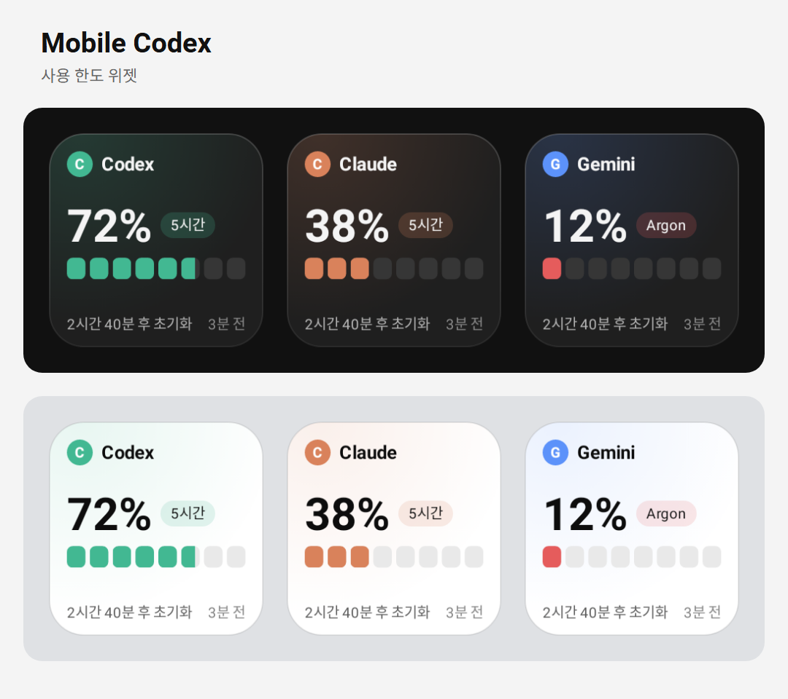

# 사용 한도 위젯

Codex, Claude, Gemini를 각각 추가할 수 있는 세그먼트 게이지 위젯이다. 기본 크기는 2×2이며 가로·세로 크기를 조절할 수 있다. 밝은 테마와 어두운 테마를 지원한다.

[작은 크기·확장형·가로형](images/usage-widgets-sizes.png)

이미지의 사용량과 시간은 표시 예시다.

## 동작

- Codex는 현재 선택된 ChatGPT 계정의 한도를 사용한다. Claude와 Gemini는 기존 Claude Code·Antigravity 연결을 사용한다.
- 남은 비율이 가장 작은 유효 한도를 상단 숫자와 게이지에 함께 표시한다. 20% 이하는 게이지와 한도 칩을 빨간색으로 표시하고, 서비스 뱃지와 카드 틴트는 서비스 색을 유지한다.
- 게이지는 기본 8칸, 넓은 가로형은 10칸으로 나눈다. 100dp 미만의 작은 크기는 칸이 너무 작아지므로 이어진 바로 표시하고, 한도 종류는 `5h`, `7d`처럼 줄여 쓴다.
- 세로로 긴 크기는 한도별 미니 바를 최대 3개, 넓은 가로형은 두 번째 한도의 미니 바를 함께 표시한다. 하단 줄에 초기화 시간과 마지막 확인 시각을 놓고, 폭이 부족하면 초기화 문구를 줄인다.
- 한도 칩은 `주간`, `5시간`처럼 한도 종류를 표시한다. Gemini는 모델별 한도이므로 `Argon 주간`처럼 모델 이름을 함께 쓰고, 폭이 부족하면 모델 이름만 표시한다. 미니 바는 긴 이름이 잘려도 종류가 보이도록 `주간 · Gemini 4 Argon` 순서로 쓴다.
- 위젯 이미지는 기기 해상도에 맞춰 그리되 최대 100만 픽셀로 제한한다.
- 마지막 조회 결과를 저장하고, 앱에서 사용량이 바뀌거나 위젯 갱신 작업이 완료되면 화면을 갱신한다. 주기적 갱신 요청은 30분 간격이며 실제 실행 시점은 Android가 결정한다.
- 새로고침은 해당 서비스만 조회한다. 100dp 미만의 작은 크기에서는 새로고침 버튼을 숨긴다. 위젯 본문을 누르면 해당 서비스의 계정 설정을 연다.
- 지원 대상은 홈 화면이다. 잠금화면용 선언(`keyguard`)은 유지하지만 추가 가능 여부는 기기의 위젯 호스트에 달려 있으며, SM-S936N(Android 16)에서는 잠금화면에 추가할 수 없었다.

## 이어서 작업할 부분

- 서비스 뱃지의 첫 글자는 임시 표시이며 Codex와 Claude가 같은 글자다. 아이콘을 정하면 교체한다.
- 실제 기기에서 크기 조절·새로고침 버튼 동작·어두운 테마를 검증한다.
- 별도 `mobile-usage` 프로젝트는 디자인 확인 후 진행하기로 했으며 아직 만들지 않았다.

## 검증 상태

Java 소스와 Android 리소스 컴파일, `UsageWidgetDataTest` 7개, `UsageWidgetTest` Robolectric 단위 테스트 7개를 확인했다. 문서 이미지는 Robolectric 네이티브 그래픽 모드에서 실제 렌더러 출력으로 만들었으며, 새로고침 버튼은 이미지에 포함되지 않는다. 별도 패키지로 만든 테스트 빌드를 SM-S936N(밝은 테마)에 설치해 2×2와 3×1 위젯의 홈 화면 표시와 실제 계정 한도를 확인했다. 기존 앱은 서명이 달라 덮어쓰지 않았다.

빌드 환경 준비는 [README의 소스 빌드 안내](../README.md#build-from-source)를 따른다.
